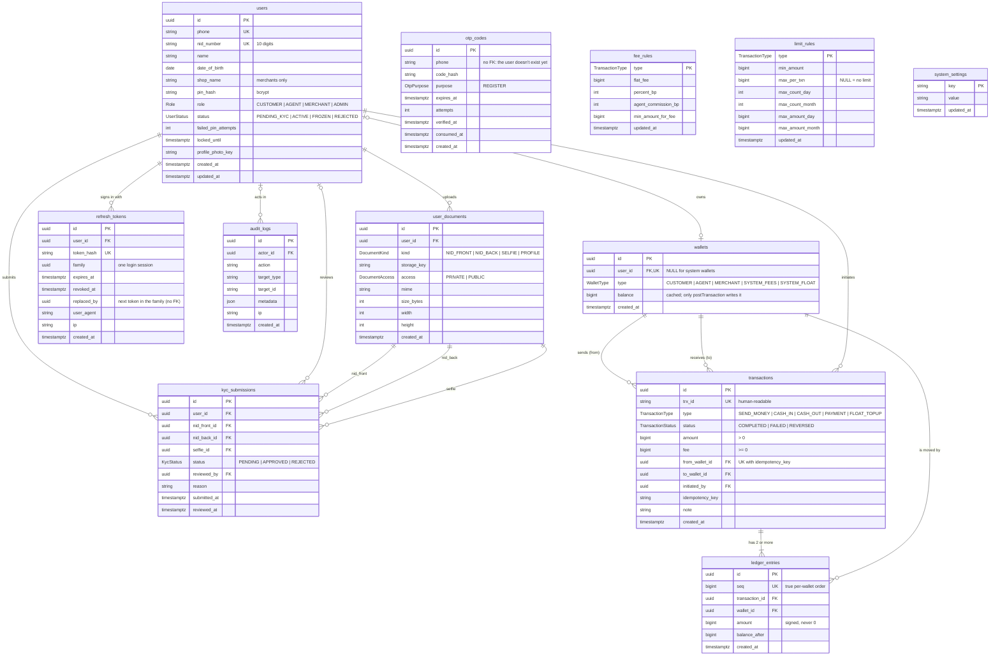

# PocketPay ER diagram

All 12 tables, generated from [`server/prisma/schema.prisma`](../../server/prisma/schema.prisma)
(column names as stored in Postgres). Money columns are `bigint` poisha (৳1 = 100). The check
constraints and triggers that guard the money tables are listed in
[design.md §8.5](../design.md#85-database-guards).

`otp_codes`, `fee_rules`, `limit_rules` and `system_settings` have no foreign keys: OTPs are
keyed by phone before an account exists, and the rule tables are keyed by transaction type.
